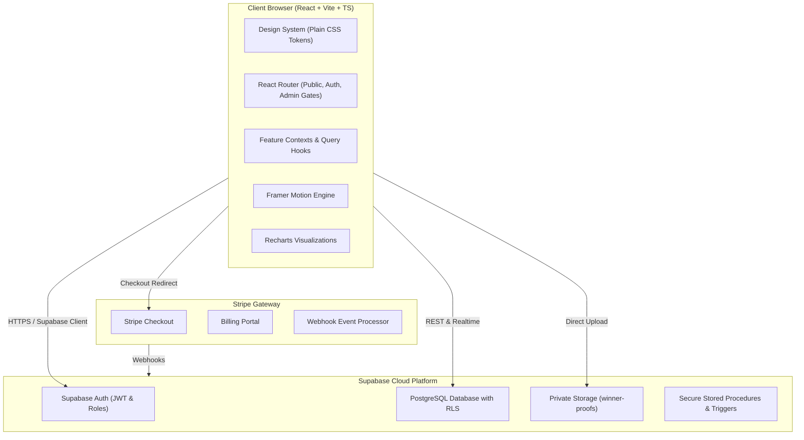
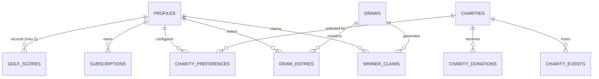
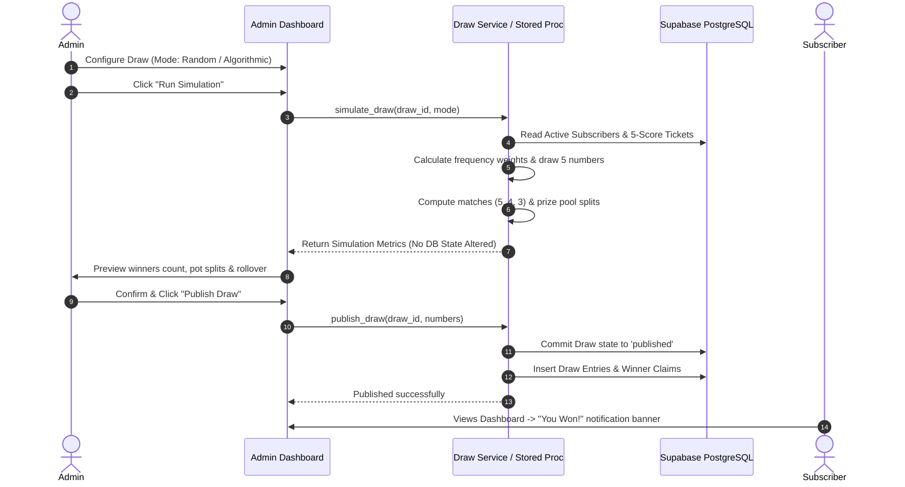

# GreenPulse — System Architecture & Technical Specification

**Project:** GreenPulse  
**Tagline:** Play with purpose. Create lasting impact.  
**Stack:** React, TypeScript, Vite, React Router, Supabase (PostgreSQL, Auth, Storage, RLS), Framer Motion, Recharts  
**Document Status:** Foundation Architecture Document

---

## 1. System Overview & Architectural Topology

GreenPulse is structured as a decoupled, cloud-native application combining a high-performance React Single Page Application (SPA) with a resilient Supabase BaaS (PostgreSQL database, Row Level Security, Storage, Auth, and Edge Functions) and Stripe payment gateway.



---

## 2. Database Schema & Relational Model

The database is built on PostgreSQL inside Supabase, enforcing referential integrity, constraints, triggers, and comprehensive Row Level Security (RLS).



### Table Definitions

#### 1. `profiles`
Represents the platform users, roles, and golfer metadata.
```sql
CREATE TABLE public.profiles (
    id UUID PRIMARY KEY REFERENCES auth.users(id) ON DELETE CASCADE,
    email TEXT NOT NULL UNIQUE,
    full_name TEXT NOT NULL,
    avatar_url TEXT,
    role TEXT NOT NULL DEFAULT 'subscriber' CHECK (role IN ('subscriber', 'admin')),
    handicap NUMERIC(4, 1),
    home_club TEXT,
    created_at TIMESTAMPTZ NOT NULL DEFAULT NOW(),
    updated_at TIMESTAMPTZ NOT NULL DEFAULT NOW()
);
```

#### 2. `subscriptions`
Tracks real-time Stripe subscription status, plans, and renewal dates.
```sql
CREATE TABLE public.subscriptions (
    id UUID PRIMARY KEY DEFAULT gen_random_uuid(),
    user_id UUID NOT NULL REFERENCES public.profiles(id) ON DELETE CASCADE,
    stripe_customer_id TEXT UNIQUE,
    stripe_subscription_id TEXT UNIQUE,
    plan_tier TEXT NOT NULL CHECK (plan_tier IN ('monthly', 'yearly')),
    status TEXT NOT NULL CHECK (status IN ('active', 'trialing', 'past_due', 'canceled', 'unpaid', 'incomplete')),
    current_period_start TIMESTAMPTZ NOT NULL,
    current_period_end TIMESTAMPTZ NOT NULL,
    cancel_at_period_end BOOLEAN NOT NULL DEFAULT FALSE,
    created_at TIMESTAMPTZ NOT NULL DEFAULT NOW(),
    updated_at TIMESTAMPTZ NOT NULL DEFAULT NOW()
);
CREATE INDEX idx_subscriptions_user_status ON public.subscriptions(user_id, status);
```

#### 3. `golf_scores`
Stores the golfer's Stableford scores (1–45). Only the latest 5 scores are retained per user, rolling automatically.
```sql
CREATE TABLE public.golf_scores (
    id UUID PRIMARY KEY DEFAULT gen_random_uuid(),
    user_id UUID NOT NULL REFERENCES public.profiles(id) ON DELETE CASCADE,
    score INTEGER NOT NULL CHECK (score >= 1 AND score <= 45),
    played_at DATE NOT NULL,
    course_name TEXT,
    verified BOOLEAN NOT NULL DEFAULT FALSE,
    created_at TIMESTAMPTZ NOT NULL DEFAULT NOW(),
    CONSTRAINT unique_user_date UNIQUE (user_id, played_at)
);
CREATE INDEX idx_golf_scores_user_played ON public.golf_scores(user_id, played_at DESC);
```

#### 4. `charities`
Registered charity directory with mission profiles and impact metrics.
```sql
CREATE TABLE public.charities (
    id UUID PRIMARY KEY DEFAULT gen_random_uuid(),
    name TEXT NOT NULL,
    slug TEXT NOT NULL UNIQUE,
    tagline TEXT,
    description TEXT NOT NULL,
    category TEXT NOT NULL CHECK (category IN ('environment', 'youth_sports', 'health', 'community')),
    logo_url TEXT,
    cover_image_url TEXT,
    website_url TEXT,
    is_featured BOOLEAN NOT NULL DEFAULT FALSE,
    total_raised_cents BIGINT NOT NULL DEFAULT 0,
    created_at TIMESTAMPTZ NOT NULL DEFAULT NOW(),
    updated_at TIMESTAMPTZ NOT NULL DEFAULT NOW()
);
```

#### 5. `charity_preferences`
User's designated charity and contribution percentage (minimum 10%).
```sql
CREATE TABLE public.charity_preferences (
    id UUID PRIMARY KEY DEFAULT gen_random_uuid(),
    user_id UUID NOT NULL UNIQUE REFERENCES public.profiles(id) ON DELETE CASCADE,
    charity_id UUID NOT NULL REFERENCES public.charities(id) ON DELETE RESTRICT,
    percentage INTEGER NOT NULL DEFAULT 10 CHECK (percentage >= 10 AND percentage <= 100),
    updated_at TIMESTAMPTZ NOT NULL DEFAULT NOW()
);
```

#### 6. `charity_events`
Upcoming events (e.g. charity golf days, banquets, tournaments).
```sql
CREATE TABLE public.charity_events (
    id UUID PRIMARY KEY DEFAULT gen_random_uuid(),
    charity_id UUID NOT NULL REFERENCES public.charities(id) ON DELETE CASCADE,
    title TEXT NOT NULL,
    description TEXT,
    event_date DATE NOT NULL,
    location TEXT NOT NULL,
    registration_url TEXT,
    created_at TIMESTAMPTZ NOT NULL DEFAULT NOW()
);
```

#### 7. `draws`
Monthly prize pool draw instances, execution state, winning numbers, and prize splits.
```sql
CREATE TABLE public.draws (
    id UUID PRIMARY KEY DEFAULT gen_random_uuid(),
    draw_title TEXT NOT NULL,
    draw_month DATE NOT NULL UNIQUE,
    draw_logic TEXT NOT NULL CHECK (draw_logic IN ('random', 'algorithmic')),
    status TEXT NOT NULL CHECK (status IN ('scheduled', 'simulated', 'published', 'closed')),
    winning_numbers INTEGER[] CHECK (array_length(winning_numbers, 1) = 5),
    total_eligible_subscribers INTEGER NOT NULL DEFAULT 0,
    total_prize_pool_cents BIGINT NOT NULL DEFAULT 0,
    carried_over_jackpot_cents BIGINT NOT NULL DEFAULT 0,
    tier_5_pot_cents BIGINT NOT NULL DEFAULT 0,
    tier_4_pot_cents BIGINT NOT NULL DEFAULT 0,
    tier_3_pot_cents BIGINT NOT NULL DEFAULT 0,
    tier_5_winners_count INTEGER NOT NULL DEFAULT 0,
    tier_4_winners_count INTEGER NOT NULL DEFAULT 0,
    tier_3_winners_count INTEGER NOT NULL DEFAULT 0,
    jackpot_rolled_over BOOLEAN NOT NULL DEFAULT FALSE,
    published_at TIMESTAMPTZ,
    published_by UUID REFERENCES public.profiles(id),
    created_at TIMESTAMPTZ NOT NULL DEFAULT NOW()
);
```

#### 8. `draw_entries`
Snapshot of user score tickets participating in a given monthly draw.
```sql
CREATE TABLE public.draw_entries (
    id UUID PRIMARY KEY DEFAULT gen_random_uuid(),
    draw_id UUID NOT NULL REFERENCES public.draws(id) ON DELETE CASCADE,
    user_id UUID NOT NULL REFERENCES public.profiles(id) ON DELETE CASCADE,
    numbers_snapshot INTEGER[] NOT NULL,
    matched_count INTEGER,
    match_tier TEXT CHECK (match_tier IN ('tier_5', 'tier_4', 'tier_3', 'none')),
    prize_awarded_cents BIGINT DEFAULT 0,
    created_at TIMESTAMPTZ NOT NULL DEFAULT NOW(),
    CONSTRAINT unique_draw_user UNIQUE (draw_id, user_id)
);
```

#### 9. `winner_claims`
Winner verification submissions, proof documents, admin audit, and payout status.
```sql
CREATE TABLE public.winner_claims (
    id UUID PRIMARY KEY DEFAULT gen_random_uuid(),
    draw_id UUID NOT NULL REFERENCES public.draws(id) ON DELETE CASCADE,
    user_id UUID NOT NULL REFERENCES public.profiles(id) ON DELETE CASCADE,
    draw_entry_id UUID NOT NULL REFERENCES public.draw_entries(id) ON DELETE CASCADE,
    prize_amount_cents BIGINT NOT NULL,
    match_tier TEXT NOT NULL CHECK (match_tier IN ('tier_5', 'tier_4', 'tier_3')),
    status TEXT NOT NULL DEFAULT 'pending_proof' CHECK (status IN ('pending_proof', 'under_review', 'verified', 'rejected', 'paid')),
    proof_image_path TEXT,
    golfer_notes TEXT,
    rejection_reason TEXT,
    admin_notes TEXT,
    reviewed_by UUID REFERENCES public.profiles(id),
    reviewed_at TIMESTAMPTZ,
    payout_reference TEXT,
    paid_at TIMESTAMPTZ,
    created_at TIMESTAMPTZ NOT NULL DEFAULT NOW(),
    updated_at TIMESTAMPTZ NOT NULL DEFAULT NOW()
);
```

---

## 3. Database Triggers & Automations

### 5-Score Rolling FIFO Trigger
When a user adds a score, if their count exceeds 5, the oldest score is automatically deleted (retaining strictly the latest 5 in reverse chronological order):
```sql
CREATE OR REPLACE FUNCTION public.handle_score_rolling()
RETURNS TRIGGER AS $$
BEGIN
    DELETE FROM public.golf_scores
    WHERE id IN (
        SELECT id FROM public.golf_scores
        WHERE user_id = NEW.user_id
        ORDER BY played_at DESC, created_at DESC
        OFFSET 5
    );
    RETURN NEW;
END;
$$ LANGUAGE plpgsql SECURITY DEFINER;

CREATE TRIGGER trg_score_rolling
AFTER INSERT ON public.golf_scores
FOR EACH ROW EXECUTE FUNCTION public.handle_score_rolling();
```

---

## 4. Authentication, Authorization & Security (RLS)

### Role-Based Access Control (RBAC)
- **Public Visitor:** Read published charities, view landing page, read draw mechanics.
- **Registered Subscriber:** Full access to their own dashboard, score management, charity preferences, draw participation status, and proof upload.
- **Administrator:** Full platform operations, user profile inspection, score override, draw simulation & publish, charity CRUD, winner review, and reports analytics.

### Row Level Security Policies
```sql
-- Enable RLS on all tables
ALTER TABLE public.profiles ENABLE ROW LEVEL SECURITY;
ALTER TABLE public.golf_scores ENABLE ROW LEVEL SECURITY;
ALTER TABLE public.subscriptions ENABLE ROW LEVEL SECURITY;
ALTER TABLE public.charity_preferences ENABLE ROW LEVEL SECURITY;
ALTER TABLE public.draws ENABLE ROW LEVEL SECURITY;
ALTER TABLE public.draw_entries ENABLE ROW LEVEL SECURITY;
ALTER TABLE public.winner_claims ENABLE ROW LEVEL SECURITY;

-- Profiles: Public can read basic profile, users edit own, admins edit all
CREATE POLICY "Users read own profile" ON public.profiles FOR SELECT USING (auth.uid() = id OR EXISTS (SELECT 1 FROM public.profiles WHERE id = auth.uid() AND role = 'admin'));
CREATE POLICY "Users update own profile" ON public.profiles FOR UPDATE USING (auth.uid() = id);

-- Golf Scores: Users full control over their scores; admins can inspect/edit
CREATE POLICY "Users manage own scores" ON public.golf_scores FOR ALL USING (auth.uid() = user_id OR EXISTS (SELECT 1 FROM public.profiles WHERE id = auth.uid() AND role = 'admin'));

-- Draws: Anyone can view published draws; only admins can view simulations and manage draws
CREATE POLICY "Public read published draws" ON public.draws FOR SELECT USING (status = 'published' OR EXISTS (SELECT 1 FROM public.profiles WHERE id = auth.uid() AND role = 'admin'));
CREATE POLICY "Admins manage draws" ON public.draws FOR ALL USING (EXISTS (SELECT 1 FROM public.profiles WHERE id = auth.uid() AND role = 'admin'));

-- Winner claims: Winners read/update own claims; admins manage all
CREATE POLICY "Users read own claims" ON public.winner_claims FOR SELECT USING (auth.uid() = user_id OR EXISTS (SELECT 1 FROM public.profiles WHERE id = auth.uid() AND role = 'admin'));
CREATE POLICY "Winners upload proof" ON public.winner_claims FOR UPDATE USING (auth.uid() = user_id AND status IN ('pending_proof', 'rejected'));
CREATE POLICY "Admins review claims" ON public.winner_claims FOR ALL USING (EXISTS (SELECT 1 FROM public.profiles WHERE id = auth.uid() AND role = 'admin'));
```

---

## 5. Draw Processing Engine



---

## 6. Frontend Architecture & Directory Layout

The application is structured into domain-focused feature modules:

```text
src/
├── assets/                  # Brand vectors, icons, and textures
├── components/              # Global shared UI components (Plain CSS)
│   ├── ui/                  # Button, Card, Input, Badge, Dialog, Toast, Select
│   ├── layout/              # Navbar, Footer, PageContainer, Sidebar
│   └── feedback/            # LoadingSpinner, ErrorState, EmptyState
├── features/                # Domain-driven feature vertical slices
│   ├── auth/                # Login, Signup, AuthContext, ProtectedRoute
│   ├── landing/             # Hero, Story, ImpactCalculator, HowItWorks, FAQ
│   ├── dashboard/           # User dashboard modules, summary, metrics
│   ├── scoring/             # Stableford score entry, history table, rolling view
│   ├── draws/               # Draw viewer, numbers display, countdown, past results
│   ├── charities/           # Directory, filter/search, profile page, donate
│   ├── verification/        # Winner proof upload, scorecard preview, claim status
│   └── admin/               # Admin overview, user mgmt, draw console, charity CRUD, payouts
├── hooks/                   # Shared custom hooks (useToast, useMediaQuery, useAuth)
├── lib/                     # Supabase client, Stripe helper, math & date utilities
├── styles/                  # Plain CSS design tokens, reset, typography, components
│   ├── variables.css        # Colors, fonts, spacing, shadows, radius tokens
│   ├── reset.css            # Base resets and typography rules
│   ├── components.css       # Plain CSS reusable component styling
│   └── index.css            # Global entry point
├── types/                   # Strict TypeScript interfaces and database schemas
├── App.tsx                  # Main router setup
└── main.tsx                 # App mount & global providers
```

---

## 7. Deployment & Infrastructure Strategy

- **Hosting Platform:** Vercel (clean new project deployment with automated CI/CD from Git).
- **Backend Database:** Supabase cloud project with automated migration scripts.
- **Environment Variables:**
  - `VITE_SUPABASE_URL`: Supabase project HTTPS URL.
  - `VITE_SUPABASE_ANON_KEY`: Supabase public anon key (safe for browser).
  - `VITE_STRIPE_PUBLIC_KEY`: Stripe publishable key.
  - `VITE_APP_URL`: Production root URL for auth and payment callbacks.
- **Zero Secret Exposure Policy:** No server-role keys, Stripe secret keys, or database service passwords in client-side code.
