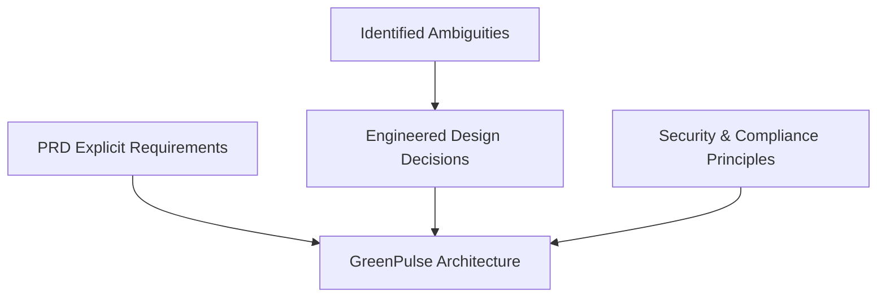

# GreenPulse — Design Decisions & Ambiguity Resolution

**Project:** GreenPulse  
**Tagline:** Play with purpose. Create lasting impact.  
**Role:** Senior Full-Stack Engineer, Product Designer, Database Architect & QA  
**Document Status:** Architectural & Design Baseline

---

## 1. Explicit PRD Requirements vs. Architectural Assumptions

To adhere strictly to the PRD while delivering a fully functional application, this section clearly separates **what the PRD explicitly demands** from **the reasoned assumptions and engineering decisions made to resolve ambiguities**.

---

## 2. Identified Ambiguities & Engineering Resolutions

### Ambiguity 1: Missing Sections in Source PDF (§ 13 Technical Requirements & § 14 Scalability)
- **PRD Observation:** The Table of Contents lists § 13 (Technical requirements, page 11) and § 14 (Scalability considerations, page 11). However, in the provided PDF, page 10 transitions directly to page 12 (§ 15 Mandatory Deliverables). The document footer explicitly states: *"ambiguity is part of the test"* (§ 17).
- **Engineering Decision:** We satisfy the technical constraints specified in both the user prompt and standard modern cloud architecture:
  - **Frontend:** React 18/19 + Vite + TypeScript, plain CSS design tokens (no Tailwind CSS), React Router v6, Framer Motion for restrained motion, Recharts for analytics.
  - **Backend:** Supabase PostgreSQL, Supabase Auth (JWT), Supabase Storage for winner proofs, Row Level Security (RLS) on all tables, and database security definer functions for sensitive draw calculations.
  - **Scalability:** Stateless frontend, server-side transactional draw execution, and index-optimized queries on scores and draws.

---

### Ambiguity 2: Draw-Entry Mapping & Score Matching Mechanics
- **PRD Explicit Requirement (§ 05, § 06):**
  - Score range is 1–45 (Stableford format).
  - Users enter their last 5 golf scores with dates; only the latest 5 are retained.
  - Draws are 5-number match, 4-number match, and 3-number match.
  - Random mode vs. Algorithmic mode (weighted by score frequency).
- **The Ambiguity:**
  1. Does a user's 5 scores act as a "lottery ticket" of 5 numbers?
  2. Does matching require exact index positions (positional) or set matching (unordered lottery style)?
  3. What if a golfer shot the same Stableford score twice in their last 5 rounds (e.g., 36, 38, 36, 40, 32)?
  4. What if a user has entered fewer than 5 scores at the time of the draw?
- **Engineering Decision & Specification:**
  - **Entry Representation:** A user’s active draw entry for a month is constituted by the distinct scores present in their active 5-round record at the draw cutoff date.
  - **Matching Logic:** Unordered set matching (standard lottery style, as referenced in § 06 *"Random — standard lottery-style"*). If the drawn 5 winning numbers are `[12, 24, 32, 36, 41]`, and a user's 5 scores contain `32, 36, 41`, that user achieves a **3-number match**.
  - **Duplicate Scores in User History:** In golf, a player can legitimately shoot 36 Stableford points on two different dates. To prevent duplicate numbers in the draw set, the entry set treats scores as unique values (`Set<number>`). If a player has duplicate scores (e.g. `[34, 36, 36, 38, 40]`), their ticket consists of the 4 unique numbers `{34, 36, 38, 40}`. To maximize match opportunities, the UI advises golfers that diverse scores expand their draw coverage.
  - **Fewer than 5 Scores:** To participate in the draw, a subscriber must have entered at least 3 scores to be eligible for a 3-match, but the PRD states in § 05 *"Users must enter their last 5 golf scores"*. Hence, the system requires 5 scores to activate ticket eligibility, preventing incomplete participation.

---

### Ambiguity 3: Subscription Pricing & Prize Pool Math
- **PRD Explicit Requirement (§ 04, § 07, § 08):**
  - Monthly plan and yearly plan (discounted rate).
  - A fixed portion of each subscription contributes to the prize pool.
  - Minimum charity contribution: 10% of subscription fee.
  - Prize pool distribution: 40% (5-match jackpot), 35% (4-match), 25% (3-match).
  - Unclaimed 5-match jackpot rolls over.
- **The Ambiguity:**
  - What are the default prices?
  - What exact percentage of the subscription goes to the prize pool vs charity vs platform operations?
- **Engineering Decision & Baseline Configuration:**
  - **Pricing Tier:**
    - Monthly: **£19.00 / month** (or $19 / €19 configurable).
    - Yearly: **£190.00 / year** (giving 2 months free, ~17% discount).
  - **Fund Allocation Split:**
    - **Prize Pool:** 40% of net subscription revenue.
    - **Charity Contribution:** 10% minimum (user can increase up to 50% via slider).
    - **Platform Operations & Host Fee:** Remainder (50% base, decreasing if charity % increases).
  - **Prize Pool Breakdown:**
    - Tier 1 (5-Number Match): 40% of monthly prize pool + prior unallocated rollover.
    - Tier 2 (4-Number Match): 35% of monthly prize pool.
    - Tier 3 (3-Number Match): 25% of monthly prize pool.
  - **Rollover Mechanics:** If 0 users hit 5 numbers, the entire Tier 1 pool carries over to `next_draw_jackpot_seed`. Tier 2 and Tier 3 funds that have 0 winners are credited to the platform charity reserve fund for that cycle rather than rolling over (§ 07 explicitly specifies rollover *only* for the 5-match tier).

---

### Ambiguity 4: Algorithmic Draw Mode ("Weighted by Score Frequency")
- **PRD Explicit Requirement (§ 06):**
  - Draw logic options: `Random` (standard lottery-style) and `Algorithmic` (weighted by score frequency).
- **The Ambiguity:**
  - Does "weighted by score frequency" mean numbers that users scored *more frequently* are *more likely* to be drawn (increasing winners), or *less likely* (protecting jackpot size), or weighted by nationwide golf distribution?
- **Engineering Decision:**
  - In golf Stableford scoring, scores follow a bell curve centered around 30–36 points.
  - The Admin can select between:
    1. **Random (Standard Lottery):** Uniform pseudo-random distribution across numbers 1–45 using cryptographic randomness (`crypto.getRandomValues`).
    2. **Algorithmic (Frequency Weighted):** Calculates the frequency distribution of all active subscriber scores in the current draw cycle. When generating winning numbers, probability weights are proportional to user score frequencies, creating a higher probability of community matches and maximizing prize distribution excitement.
  - Full transparency: The Admin Draw Console displays the probability distribution graph and lets admins run simulations before committing.

---

### Ambiguity 5: Winner Verification & Payment Lifecycle
- **PRD Explicit Requirement (§ 09):**
  - Verification applies to winners only.
  - Proof upload: Screenshot of scores from golf platform (e.g., Golf Genius, HowDidiDo, WHS app).
  - Admin review: Approve or reject.
  - Payment states: `Pending` -> `Paid`.
- **Engineering Decision & Workflow State Machine:**
  - **Claim States:**
    1. `eligible` / `unclaimed`: Winner announced in draw. User notified on dashboard.
    2. `proof_submitted`: Winner uploads screenshot proof with optional round verification notes.
    3. `under_review`: Admin reviewing submission in Admin Panel.
    4. `verified`: Admin approves authenticity of the golf score screenshot.
    5. `rejected`: Admin rejects (with mandatory reason, e.g. "Scorecard date does not match round date"). User can re-upload.
    6. `paid`: Payout executed (bank transfer / Stripe transfer) and marked completed by Admin with payout reference.

---

## 3. Security & Integrity Decisions

1. **Strict Key Segregation:**
   - Client code only possesses `VITE_SUPABASE_ANON_KEY` and `VITE_SUPABASE_URL`.
   - Never expose `SUPABASE_SERVICE_ROLE_KEY` or Stripe private secrets in frontend bundles.
2. **Row Level Security (RLS):**
   - Users can only read and write their own scores (`user_id = auth.uid()`).
   - Non-admins can never read other users' proof uploads (`winner-proofs` bucket requires winner identity or admin claim).
   - Only admins (verified via `profiles.role = 'admin'` or custom claim) can access admin RPCs and tables.
3. **Audit Trail:**
   - All draw simulations and published draws log the executing admin user ID, timestamp, algorithm parameters, and generated numbers.
   - Payout state changes record the admin user ID and timestamp.
