# GreenPulse — Phased Implementation Plan & Acceptance Criteria

**Project:** GreenPulse  
**Tagline:** Play with purpose. Create lasting impact.  
**Source of Truth:** Digital Heroes PRD (Level 1)  
**Document Status:** Phased Roadmap & Deliverable Roadmap

---

## 1. Phased Development Roadmap

```mermaid
graph LR
    Phase1[Phase 1: Foundation & Design System] --> Phase2[Phase 2: Auth, Routing & Profiles]
    Phase2 --> Phase3[Phase 3: Subscriptions & Charity Integration]
    Phase3 --> Phase4[Phase 4: Score Management & Rolling Engine]
    Phase4 --> Phase5[Phase 5: Draw Engine, Rollover & Simulation]
    Phase5 --> Phase6[Phase 6: Winner Verification & Proof Pipeline]
    Phase6 --> Phase7[Phase 7: Full Admin Control Console & Analytics]
    Phase7 --> Phase8[Phase 8: Polish, Auditing & Cloud Deployment]
```

---

## 2. Phase Breakdown & Acceptance Criteria

### Phase 1: Foundation, Architecture & Design System (Current Phase)
- **Scope:**
  1. Inspect complete PRD and document all requirements, ambiguities, and architectural solutions.
  2. Create clean React 18/19 + Vite + TypeScript application scaffold.
  3. Formulate strict design tokens (Plain CSS variables): Warm cream (`#FBF9F4`), Forest green (`#123524`), Muted lime (`#8EA633`), Charcoal (`#1A1D1A`), refined serif/sans typography, spacing, elevations, borders.
  4. Build reusable foundation components: Button (variants: primary, secondary, outline, ghost), Card, Badge, Form Fields, Modal/Dialog, and Toast notification system.
  5. Setup feature-based folder structure and strict TypeScript configuration.
- **Acceptance Criteria:**
  - `npm run build` passes with zero TypeScript warnings or errors.
  - Plain CSS only (zero Tailwind CSS usage).
  - Design system tokens active and verified on a living showcase/landing view.
  - Project documentation files committed: `PRD_ANALYSIS.md`, `DESIGN_DECISIONS.md`, `ARCHITECTURE.md`, `IMPLEMENTATION_PLAN.md`.

---

### Phase 2: Authentication, Authorization & User Profile
- **Scope:**
  1. Configure Supabase client with public anon key.
  2. Implement Supabase Auth (Sign Up, Sign In, Sign Out, Password Reset).
  3. Auto-provision `profiles` table on signup with role assignment (`subscriber` vs `admin`).
  4. Build Protected Route guards for Subscriber and Admin routes.
  5. Profile settings page (name, handicap, home club, avatar).
- **Acceptance Criteria:**
  - Users can sign up and sign in seamlessly.
  - Invalid credentials show clear, accessible inline errors.
  - Admin users are routed to `/admin`; regular subscribers are routed to `/dashboard`.
  - Non-authenticated visitors attempting to access protected routes are gracefully redirected to `/login`.

---

### Phase 3: Subscriptions & Charity Selection Engine
- **Scope:**
  1. Subscription plan selection interface (Monthly £19 / Yearly £190 discounted).
  2. Stripe Checkout session integration & webhook handlers for subscription lifecycle (`active`, `past_due`, `canceled`).
  3. Charity directory browsing with category filters (environment, youth sports, health, community).
  4. Charity selection during signup/onboarding with interactive contribution slider (min 10%, up to 100%).
  5. Independent donation flow for direct charity giving (not tied to gameplay).
  6. Dedicated Charity Profile pages (`/charities/:slug`) with rich media and upcoming events (e.g. Golf Days).
- **Acceptance Criteria:**
  - User cannot proceed past onboarding without selecting a charity with at least 10% contribution.
  - Standalone donations execute cleanly via payment checkout without altering draw tickets.
  - Charity directory provides instant search and category filtering.

---

### Phase 4: Stableford Score Management System
- **Scope:**
  1. Score entry form with input validation: Stableford score integer between 1 and 45.
  2. Date picker restricting to one entry per date (`UNIQUE(user_id, played_at)`).
  3. Rolling FIFO storage engine: Automatically retains strictly the latest 5 scores; 6th score insertion drops the oldest.
  4. Reverse chronological display table with visual indicators for score trends.
  5. Score edit and delete modals with instant optimistic updates and DB sync.
- **Acceptance Criteria:**
  - Submitting score < 1 or > 45 fails with clear validation error.
  - Submitting a duplicate date prompts the user to edit the existing round or choose another date.
  - Inserting a 6th score maintains exactly 5 scores in the database and UI, correctly discarding the oldest.

---

### Phase 5: Monthly Draw & Prize Pool Reward System
- **Scope:**
  1. Prize pool calculator: 40% of subscription revenue pool split into Tier 1 (40% + rollover), Tier 2 (35%), Tier 3 (25%).
  2. Match evaluation algorithm: Compares drawn 5 numbers with user distinct scores for 5-match, 4-match, 3-match.
  3. Dual draw generation logic:
     - *Random:* Cryptographically uniform random selection (1–45).
     - *Algorithmic:* Weighted by active subscriber score frequencies.
  4. Rollover engine: Carries forward unclaimed Tier 1 jackpot to the next draw cycle.
  5. User dashboard participation view: Active tickets, draw countdown, and match history.
- **Acceptance Criteria:**
  - Multi-winner splits calculate accurately to the exact penny/cent.
  - Rollover correctly increments next month's Tier 1 pot if 0 users match 5 numbers.
  - Draws remain in draft/scheduled status until explicitly published.

---

### Phase 6: Winner Verification & Proof Upload Pipeline
- **Scope:**
  1. Winner detection & notification banners on user dashboard upon draw publication.
  2. Secure proof upload form: Golfer uploads golf platform screenshot (Golf Genius, HowDidiDo, WHS app).
  3. Supabase Storage bucket integration (`winner-proofs`) with restricted access policies.
  4. Admin verification desk: View submitted screenshots, inspect round dates, approve or reject with reason.
  5. Payment status tracker: `pending_proof` -> `under_review` -> `verified` -> `paid`.
- **Acceptance Criteria:**
  - Only genuine winners can access the proof upload portal.
  - Admin rejection updates user status with detailed feedback for re-submission.
  - Payout marked as completed locks the record and records audit metadata.

---

### Phase 7: Comprehensive Admin Control Console & Analytics
- **Scope:**
  1. User Management surface: View all profiles, filter by subscription state, edit profile and scores.
  2. Draw Management surface: Configure logic, run non-destructive simulations, preview winners and payouts, publish draw.
  3. Charity Management surface: Add, edit, delete charities, manage events and media.
  4. Winner Management surface: Full claims queue, scorecard inspector, payout toggle.
  5. Reports & Analytics: Recharts dashboards displaying total subscribers, accumulated prize pools, charity fund totals, and draw statistics.
- **Acceptance Criteria:**
  - Non-admins cannot access `/admin` or execute administrative RPC functions.
  - Simulation preview creates zero persistent state changes until "Publish" is confirmed.
  - Analytics numbers accurately reflect database sums.

---

### Phase 8: Hardening, Accessibility, QA & Deployment
- **Scope:**
  1. Mobile and desktop responsive design audits.
  2. WCAG AA contrast check across warm cream and forest green color palette.
  3. Comprehensive error boundary handling and toast feedback across all async actions.
  4. Deployment to clean Supabase project and Vercel hosting.
  5. Seed script generating demo accounts (Admin, Active Golfer, Pending Winner, Inactive Subscriber).
- **Acceptance Criteria:**
  - 100% functional UI with zero mock/fake buttons.
  - Live accessible URL with all environment variables verified.
  - Ready for final recruitment evaluation.
